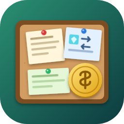

<p align="center"></p>

# AgoraBoard - Bulletin Board & Trade Market

[Русская версия: README.ru.md](README.ru.md)

**A server-wide bulletin board for your players: announcements, safe item trades with escrow, money offers, and optional chat posting - all through a clean in-game menu.**

Works on **Paper, Folia and Spigot**, Minecraft **1.18.2 - 26.3**, Java 17+. Perfect for vanilla-style, survival and economy servers: no more "WTS diamonds" spam in chat, no more scams.

---

## Features

### Announcements
- Players post announcements by category (the categories, their icons and names are set in the config).
- Lifetime, per-player limit (default **2**), text length and blocked words are configurable (default lifetime **10 days**).
- Paginated menu with a category filter and a "my announcements" view.
- One click on someone's announcement shows how to contact the author (`/msg` - the command is configurable). Click your own to manage it: post it to the chat again or delete it.

### Trades with escrow (GUI mode)
- Post what you **need** (one item, any amount - even more than a stack) and what you **give** in return (several items with amounts, **money**, or both), plus an optional description (enchantments, conditions...).
- Your offered items (and money) are taken and held by the board when you create the trade, so nobody can be scammed: if the taker has what you asked for, the exchange is completed automatically from the menu.
- The owner is notified (immediately or on next join) and collects the payment from a separate "receive items" menu - nothing is lost if the inventory is full or the owner is offline.
- Cancelling, expiry or removal by a moderator returns the items **and the reserved money** to the owner.
- **Negotiable** trades: put `negotiable` instead of the offer - it works as an announcement, nothing is taken, the players agree privately.
- **NATURAL mode** (optional): the board only displays trades, nothing is held or exchanged automatically.
- The list icon shows the item the owner **needs**, so players find what they can fulfil at a glance. Search by item with `/board find`.
- Default limit **5** trades per player (configurable).

### Money (Vault)
- Offer **money instead of items or together with them**: `/board trade diamond 5 money 250`. Min/max sums are configurable.
- Money is withdrawn (reserved) when the trade is created, refunded on cancel/expiry/removal and paid to the player who accepts the trade.
- Optional **posting prices** for announcements, trades and chat posts. A price of `0` is free and is not shown anywhere.
- Works with any economy plugin through **Vault** (EssentialsX, CMI, ...). Without Vault the plugin still works - prices and money offers are simply disabled.

### Chat posting
- Add `-c` to a command (or press the button in the menu) to also announce a listing in the public chat; re-post it later at any time.
- Free posting has a shared cooldown (default **30 min**, one for all of the player's listings); paid posting has a price and no cooldown.
- Works with chat plugins - pick the mode that fits:
  - `BROADCAST` - the plugin broadcasts a formatted message with clickable buttons (works everywhere),
  - `COMMAND` - runs your own console commands (EssentialsX `broadcast`, ChatControl, ...),
  - `PLAYER` - sends the text as the player so your chat plugin applies its formats and rules.

### Fully customisable texts
- Every message, menu title, button and the **plugin prefix** live in `lang/<language>.yml` (MiniMessage: colours, gradients, hover/click).
- **English and Russian** included - copy a file and translate it to add your own language.
- `/board admin reload` applies changes without a restart.

### Permissions for everything
Separate permissions for each command, creating listings, chat posting, **deleting other players' listings** and **posting other players' listings to the chat**. Moderators get a "Shift + right click" menu on foreign listings.

### Built for modern servers
- One jar for **Paper, Folia (region-thread safe) and Spigot**.
- Data in a simple YAML file, async-safe saving. Trade logic is all-or-nothing (no dupes, no lost items).
- Lightweight: no database needed, no required dependencies.

---

## Commands

| Command | Description |
|---|---|
| `/board` (`/agora`, `/doska`) | Open the main menu |
| `/board ads` / `/board trades` | Open the list of announcements / trades |
| `/board ad [-c] <category> <text>` | Post an announcement (`-c` also posts it to the chat) |
| `/board trade [-c] <need> [amount] <give> <amount> ... [money <sum>] [description]` | Create a trade |
| `/board trade <need> [amount] negotiable [description]` | Create a negotiable trade |
| `/board find <item>` | Search trades that need an item |
| `/board claim` | Collect items you are owed |
| `/board help` | Help |
| `/board admin <reload, list, remove, selftest>` | Administration (`remove <ad or trade> <id>`) |

Example: `/board trade diamond 5 iron_ingot 64 money 250 Unenchanted please`

## Permissions

| Permission | Default | Description |
|---|---|---|
| `agoraboard.use` | everyone | Open the board and its menus |
| `agoraboard.command.help` / `ads` / `trades` / `find` / `claim` | everyone | The matching command (`agoraboard.command.*` for all) |
| `agoraboard.ad` / `agoraboard.trade` | everyone | Create announcements / create and accept trades |
| `agoraboard.chat` | everyone | Post own listings to the chat |
| `agoraboard.chat.others` | op | Post other players' listings to the chat |
| `agoraboard.remove.ad` / `agoraboard.remove.trade` | op | Delete other players' announcements / trades (`agoraboard.remove.*` for both) |
| `agoraboard.admin.reload` / `list` / `selftest` | op | The matching `/board admin` sub-command |
| `agoraboard.admin` | op | All admin commands, removal and chat posting of others |
| `agoraboard.unlimited` | op | No limits, cooldowns or prices |

## Quick configuration

```yaml
language: en            # en, ru or your own file in lang/
trade-mode: GUI         # GUI = automatic escrow trades, NATURAL = display only
message-command: msg    # command used by the "contact" buttons
notify-on-join: true    # show the board summary on join
ads:    { max-per-player: 2, duration-days: 10, price: 0 }
trades: { max-per-player: 5, duration-days: 10, price: 0, money: { enabled: true, min: 1, max: 0 } }
chat:   { enabled: true, mode: BROADCAST, price: 0, cooldown-minutes: 30 }
```

## Installation
1. Put `AgoraBoard.jar` into `plugins/`.
2. (Optional) Install **Vault** and an economy plugin for prices and money trades.
3. Start the server, edit `plugins/AgoraBoard/config.yml` and `lang/`, then `/board admin reload`.

## Compatibility
- Paper, Folia and Spigot, **1.18.2 - 26.3**, Java 17 or newer.
- Tested live on Paper 1.18.2 / 1.20.4 / 1.21.4 / 26.3, Folia 1.20.4 / 26.2 and Spigot 1.20.4 with an automatic self-test (`/board admin selftest`); other versions in the range are checked against the server API.
- Optional: Vault + any economy plugin.
- Items saved on Paper are not readable on Spigot and vice versa - do not move the data file between server types with active trades.

## Metrics
AgoraBoard uses [bStats](https://bstats.org/plugin/bukkit/AgoraBoard/34636) to collect anonymous usage statistics (server version, trade mode, language). You can disable it in `plugins/bStats/config.yml`.

## Building

```bash
mvn package
```
Output: `target/AgoraBoard-<version>.jar` (Java 17+).

## Support & issues

Bugs and ideas: [GitHub Issues](https://github.com/rakhmight/AgoraBoard/issues). Please include your server software, version and `/board admin selftest` output.

## License

[MIT](LICENSE)
